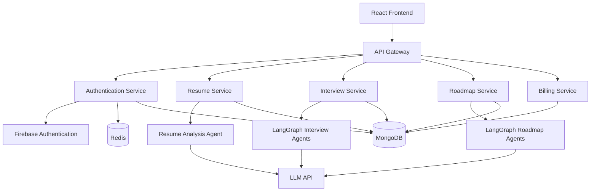
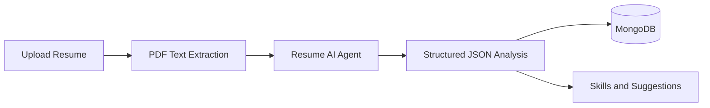
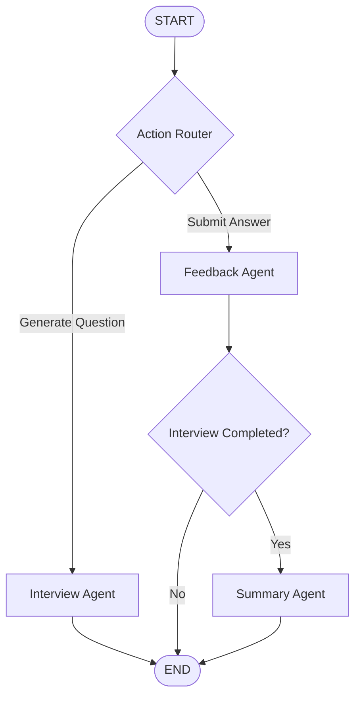
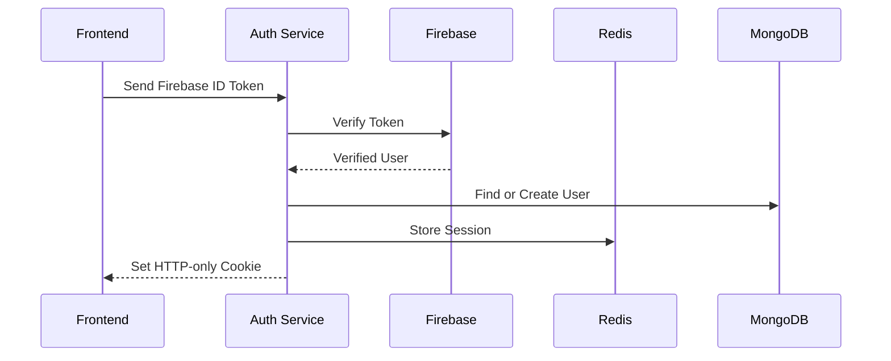

# 🚀 Fresher.ai

### Multi-Agent AI Career Preparation Platform

**Practice smarter interviews. Analyze your resume. Build a personalized roadmap for your career.**


---

## 📖 Overview

**Fresher.ai** is a full-stack, multi-agent AI-powered interview preparation and career development platform designed to help students and job seekers prepare for technical interviews, analyze their resumes, and generate personalized learning roadmaps.

The platform uses a **microservices architecture** for modularity and scalability, with **LangChain and LangGraph** for orchestrating intelligent AI agents.

It integrates resume analysis, technical mock interviews, automated answer evaluation, performance reports, and career roadmap generation into a single platform.

## ✨ Key Features

### 🤖 AI-Powered Mock Interviews
- Generate role-specific technical interview questions.
- Conduct personalized interviews based on the selected role and resume.
- Evaluate user responses using AI agents.
- Provide detailed feedback, scores, and improvement suggestions.
- Generate comprehensive interview performance reports.

### 📝 AI Resume Analyzer
- Upload resumes in PDF format.
- Extract and process resume content.
- Identify technical skills, education, experience, and projects.
- Detect skill gaps and provide actionable improvement suggestions.
- Store analyzed resume data in MongoDB.

### 🗺️ Personalized Career Roadmaps
- Generate structured learning roadmaps based on career goals.
- Break down learning paths into relevant topics and stages.
- Recommend useful learning resources.
- Use a multi-agent LangGraph workflow for roadmap generation.

### 🔐 Authentication and User Management
- Firebase-based identity authentication.
- Redis-backed session management.
- Secure HTTP-only session cookies.
- Persistent user information in MongoDB.
- Protected API routes.

### 🧩 Microservices Architecture
- Independent backend services.
- Centralized API Gateway.
- Separation of business responsibilities.
- Redis integration for sessions and caching.
- MongoDB for persistent data storage.

---

## 🛠️ Tech Stack

| Category | Technologies |
|---|---|
| Frontend | React.js, JavaScript, Vite, Tailwind CSS |
| Backend | Node.js, Express.js |
| Architecture | Microservices, REST APIs, API Gateway |
| AI Frameworks | LangChain, LangGraph |
| LLM | Groq / LLM APIs |
| Database | MongoDB, Mongoose |
| Caching | Redis |
| Authentication | Firebase Admin SDK, Redis Sessions |
| DevOps | Docker, Docker Compose |
| Cloud | AWS (deployment configuration dependent) |

---

## 🏗️ System Architecture

The platform follows a microservices architecture where the frontend communicates with an API Gateway responsible for routing requests to dedicated backend services.



### Backend Services

| Service | Responsibility |
|---|---|
| API Gateway | Central entry point and request routing |
| Authentication Service | User authentication and session management |
| Resume Service | Resume extraction and AI-powered analysis |
| Interview Service | Mock interviews, feedback, and performance reports |
| Roadmap Service | Personalized learning roadmaps and resources |
| Billing Service | Payment-related operations |

---

## 🧠 AI Agent Workflows

### 1. Resume Analysis Workflow

The resume service extracts text from an uploaded PDF and processes it using an AI agent to generate structured insights.



**Workflow:**

1. The user uploads a PDF resume.
2. Multer handles the file upload.
3. The PDF parser extracts the resume text.
4. The Resume Agent analyzes the extracted content.
5. The agent generates structured information, including skills, education, experience, projects, missing skills, and suggestions.
6. The analysis is stored in MongoDB and returned to the frontend.

### 2. AI Mock Interview Workflow

The interview service uses **LangGraph** to coordinate three specialized agents:

- **Interview Agent:** Generates interview questions.
- **Feedback Agent:** Evaluates answers and provides structured feedback.
- **Summary Agent:** Generates the final interview performance report.



**Interview workflow:**

1. The user selects an interview type, job role, and optional resume personalization.
2. The Interview Agent generates relevant questions.
3. The user submits answers.
4. The Feedback Agent evaluates each response.
5. Feedback is saved with the interview record.
6. Once the interview is completed, the Summary Agent generates the final report.

**Evaluation Metrics**

| Metric | Description |
|---|---|
| Correctness | Technical accuracy of the answer |
| Clarity | Ease of understanding |
| Relevance | Alignment with the asked question |
| Detail | Depth and completeness |
| Efficiency | Effectiveness of the explanation |
| Communication | Quality of expression |
| Problem Solving | Reasoning and approach |
| Creativity | Originality of the response |
| Overall Score | Combined performance assessment |

### 3. Personalized Roadmap Workflow

The roadmap service uses a sequential LangGraph workflow consisting of two AI agents.


**Roadmap Agent**

Generates a structured roadmap based on the user's target career, skills, and learning objectives.

**Resource Agent**

Processes the generated roadmap and recommends learning resources for its topics.

LangGraph manages execution order and transfers shared state between both agents.

---

## 🔐 Authentication Workflow

The authentication service uses Firebase for identity verification and Redis for server-side session management.



**Authentication process:**

1. The user authenticates through Firebase.
2. The frontend sends the Firebase ID token to the backend.
3. Firebase Admin SDK verifies the token.
4. The backend finds or creates the user in MongoDB.
5. A unique session identifier is generated.
6. Session information is stored in Redis with an expiration time.
7. The session identifier is sent to the browser through an HTTP-only cookie.
8. Subsequent protected requests use the session cookie for authentication.

---

## 📁 Project Structure

The project is organized into frontend and backend directories. The backend contains separate services for distinct responsibilities.

```text
freshAi/
│
├── frontend/
│   └── React Application
│
├── backend/
│   ├── API Gateway
│   ├── Authentication Service
│   ├── Resume Service
│   ├── Interview Service
│   ├── Roadmap Service
│   └── Billing Service
│
└── README.md
```

*Note: The structure above is conceptual. Actual nested directory names may differ.*

---

## ⚙️ Installation and Setup

### Prerequisites

Ensure the following are installed or configured:

- Node.js and npm
- MongoDB
- Redis
- Git
- Groq or another configured LLM API key
- Firebase project credentials
- Docker and Docker Compose (optional, depending on deployment)

### 1. Clone the Repository

```bash
git clone https://github.com/manjit665/freshAi.git
cd freshAi
```

### 2. Install Frontend Dependencies

```bash
cd frontend
npm install
```

### 3. Install Backend Dependencies

Navigate to each backend service directory containing a `package.json` file and install its dependencies.

```bash
npm install
```

### 4. Configure Environment Variables

Create the required `.env` files inside the appropriate backend services.

Example configuration:

```env
MONGODB_URL=mongodb://localhost:27017/fresherai
REDIS_URL=redis://localhost:6379
GROQ_API_KEY=your_groq_api_key
FIREBASE_PROJECT_ID=your_firebase_project_id
```

These are example variables. Check the current service source code for the exact environment variable names, ports, and additional Firebase configuration.

**Never commit your API keys or `.env` files to GitHub.**

### 5. Start Required Infrastructure

Start MongoDB and Redis locally or through the configured Docker environment.

Where a Docker Compose configuration exists, run:

```bash
docker compose up -d
```

### 6. Start Backend Services

Start the API Gateway and the individual services using the scripts defined in their respective `package.json` files.

For example:

```bash
npm run dev
```

### 7. Start the Frontend

```bash
cd frontend
npm run dev
```

Open the URL displayed by Vite in the terminal.

---

## 🔒 Security Considerations

- Firebase token verification for authenticated users.
- HTTP-only cookies for protecting session identifiers.
- Redis session expiration and server-side management.
- Environment variables for sensitive credentials.
- Authentication middleware for protected routes.
- Validation and size restrictions for uploaded files.
- Controlled API access and separation of service responsibilities.

---

## 🚀 Future Enhancements

- [ ] Voice-based AI mock interviews
- [ ] Adaptive question difficulty
- [ ] Real-time interview analytics dashboard
- [ ] Personalized improvement recommendations
- [ ] Automated testing for microservices
- [ ] Centralized monitoring and logging
- [ ] Improved deployment and container orchestration
- [ ] Expanded payment and subscription features

---

## 🎯 Project Highlights

Fresher.ai demonstrates practical implementation of:

- Full-stack MERN application development
- Microservices and API Gateway architecture
- Agentic AI workflows using LangGraph
- LangChain and LLM integration
- State-based multi-agent orchestration
- Resume parsing and structured AI output
- Redis-backed session authentication
- MongoDB data modeling
- RESTful APIs and backend service separation

---

## 👨‍💻 Author

**Manjit Das**

GitHub: [@manjit665](https://github.com/manjit665)

Repository: [Fresher.ai](https://github.com/manjit665/freshAi)

---

## 🤝 Contributing

Contributions, suggestions, and feedback are welcome.

If you would like to contribute, open an issue or submit a pull request with a description of your proposed changes.

---

**⭐ If you find Fresher.ai useful, consider starring the repository!**

*Built to make interview preparation smarter, personalized, and accessible.*
